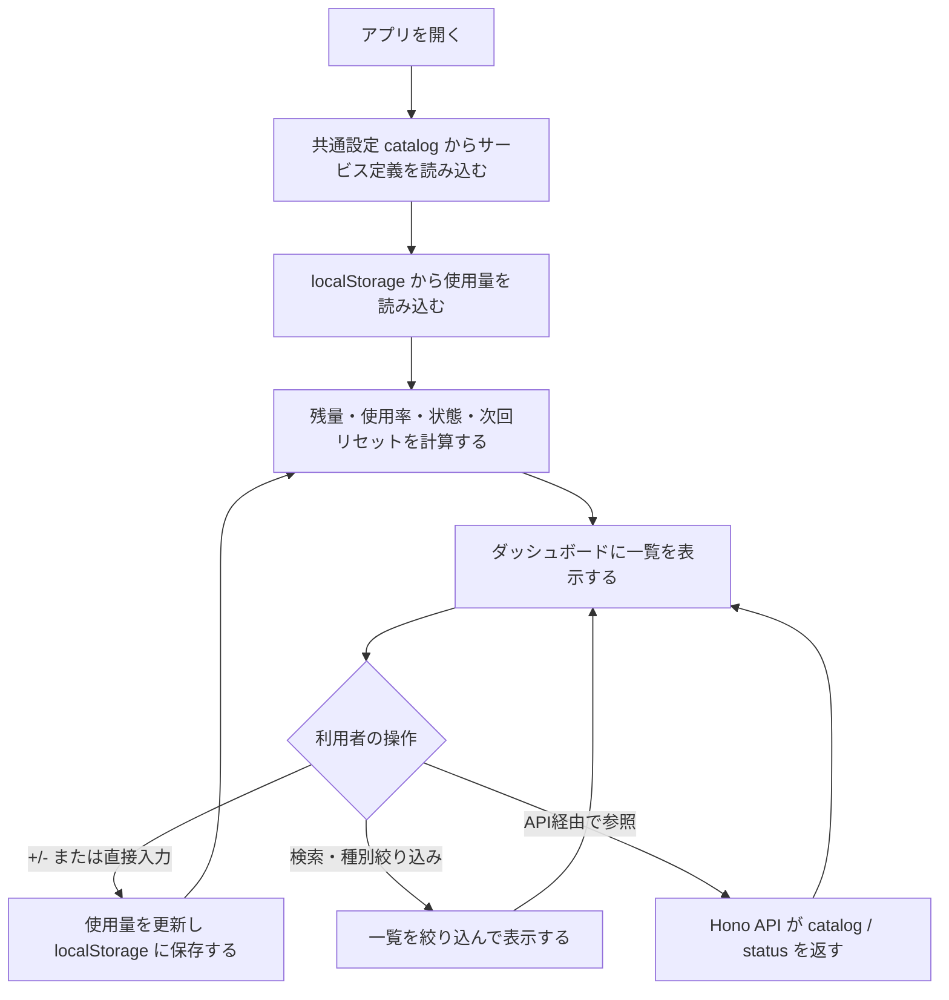

# 要件定義書 — 無料枠管理アプリ（AI動画＋ローカルエージェント）

## 1. 目的
1. ネット上のAI動画生成サービスの無料枠（上限・単位・リセット周期）を把握する。
2. ローカルの Codex / Antigravity / Muse の無料枠を同じ画面で把握・管理する。
3. 無料枠の定義は単一の情報源（`src/shared/config/catalog.ts`）でのみ管理し、公式仕様が変わっても1箇所の修正で全画面・全APIに反映されるようにする。

## 2. 配置・技術
- 配置先: ユーザーPCのローカル環境（フォルダごと配置可能な Next.js アプリ）。
- 技術: Next.js (App Router, TypeScript) + Hono（API層） + shadcn/ui スタイルの共通UIコンポーネント。
- 構成: featureベース `src/features/{video-quota,local-agent,dashboard,usage-record}` + `src/shared/{config,lib,ui}`。
- データ保存: ブラウザの localStorage（DBなし）。保存キーは共通設定から取得する。

## 3. 業務フロー

## 4. 機能要件
- F1 一覧: サービス名/種別/上限/使用量/残量/使用率/状態/次回リセットを共通設定から表示する。
- F2 使用量記録: +/- と直接入力で使用量を更新し localStorage に保存する（DBなし）。負値・上限超過は共通ロジックでクランプする。
- F3 状態判定: 使用率で 通常/注意/枯渇 を共通閾値で判定する（閾値は shared/config のみ）。
- F4 リセット: 周期（daily/weekly/monthly/5hour）から次回リセット日時を計算し表示する。
- F5 検索・絞り込み: 名前検索、種別（動画生成/ローカル）絞り込みを行う。
- F6 初期値編集の受け皿: 無料枠の初期値は共通設定ファイル1箇所を直すだけで全画面・APIに反映される。

## 5. 非機能要件
- N1 保守性: ハードコード禁止。共通項目は単一参照とし、feature間の直接依存を禁止する（shared経由のみ）。
- N2 再利用性: 計算ロジックは純粋関数 `src/shared/lib/quota.ts` に集約し、画面とAPIから再利用する。
- N3 品質: GitHub Actions で lint / typecheck / test / coverage を実行する。lint は失敗時にCIを失敗させる。
- N4 品質指標: カバレッジ対象範囲（`src/shared/lib/**` + `src/shared/config/**`）で statements/branches/functions/lines 100% を維持する。

## 6. スコープ
### 対象範囲
- AI動画生成サービスの無料枠の一覧表示・手入力管理。
- ローカルエージェント（Codex / Antigravity / Muse）の無料枠の手入力管理。
- Hono による参照用API（catalog / usage検証 / status集計）。

### スコープ外・正直な限界
- 各サービスの無料枠は公式APIで自動取得できないものが大半のため自動取得はしない。使用量は手入力、初期上限は共通設定で管理し、公式で変わったらその1箇所だけ直す。
- Muse はクラウド管理のためローカル自動取得は対象外（手入力管理）。
- ユーザー認証・複数ユーザー共有・サーバー側DB永続化は対象外。
