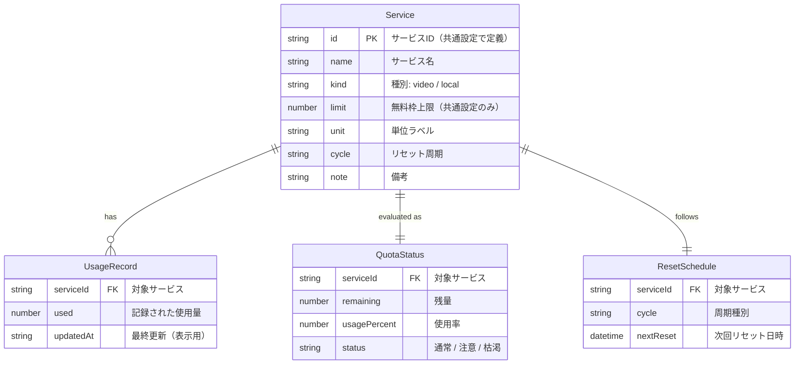

# 基本設計書 ER図（論理モデル）

本アプリは localStorage ベースであり物理DBは存在しないが、扱うデータを論理エンティティとしてモデル化する。共通項目は `00_common.md` を参照する。

## エンティティ説明
- Service: 共通設定（C-2）に定義されるマスタ。実行時に追加・削除しない。
- UsageRecord: localStorage に保存される使用量（C-5）。Service 1件につき最大1件。
- QuotaStatus: Service と UsageRecord から都度算出する派生データ。永続化しない。
- ResetSchedule: Service の周期から都度算出する派生データ。永続化しない。
